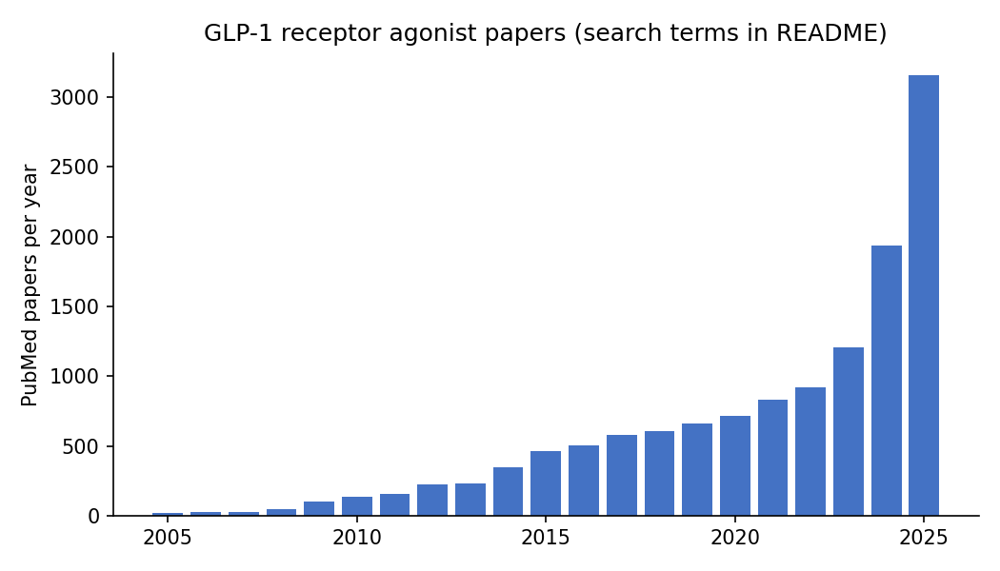
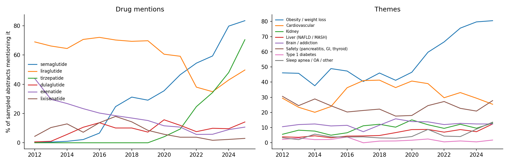

# Mining the GLP-1 literature on PubMed

GLP-1 drugs (semaglutide, liraglutide, tirzepatide and others) went from diabetes tablets-and-injections to the biggest story in medicine. I wanted to see that in the papers: how fast the literature grew, which drugs took over, and what researchers started studying. Text mining with a topic model (NMF) written from scratch in numpy.

## Data

PubMed through NCBI E-utilities (https://www.ncbi.nlm.nih.gov/books/NBK25501/). `src/fetch.py` runs this search on title and abstract: "glucagon-like peptide-1 receptor agonist", "GLP-1 receptor agonist", semaglutide, liraglutide or tirzepatide.

- Yearly paper counts, 2005 to 2025 (`data/papers_per_year.csv`).
- Up to 200 abstracts per year for 2012 to 2025, picked by PubMed's relevance ranking (2,467 usable abstracts). The abstracts file is not stored here. Run the script to rebuild it. Results may shift slightly as PubMed adds papers.

## What I found

- Papers per year: 715 in 2020, 1,207 in 2023, 1,937 in 2024 and 3,157 in 2025. The 2025 number is 4.4 times the 2020 number.
- Drug mentions in the sampled abstracts: semaglutide went from 0.6% in 2012 to 35.5% in 2020 and 83.4% in 2025. Exenatide went from 43.9% to 10.7%. Liraglutide peaked in the mid 2010s and was still in half of the sampled 2025 abstracts.
- Themes: "obesity or weight loss" appears in 46% of sampled abstracts in 2012 to 2020, and 80.5% in 2025. Kidney papers went from 5.6% to 13.0%, and liver (NAFLD/MASH) from 3.9% to 12.4%.
- Topic model (8 topics, `data/topics.csv`): the "insulin, exenatide, basal, hypoglycemia" topic was 33.9% of abstracts in 2012 and 0.6% in 2025. A "tirzepatide, GIP, dual agonist" topic went from 1.1% to 21.9%. Meta-analyses grew from 5.0% to 26.0%.




## Limits

- Drug and theme shares come from a sample of at most 200 abstracts per year ranked by relevance. They show direction, not exact shares of all papers. Years before 2012 are only in the counts.
- A keyword hit means the word appears, not that the paper studies it. A "safety" hit can be a sentence about nausea in a diabetes trial.
- The obesity share partly reflects the search terms: semaglutide and tirzepatide papers are now mostly about weight.
- NMF topics are a statistical summary and the labels are mine. A different random start gives slightly different topics (I kept the best of 3 starts).
- 2025 may be incomplete or still being indexed.

## Run it

```
pip install numpy pandas requests matplotlib
python src/fetch.py
python src/analyze.py
```
